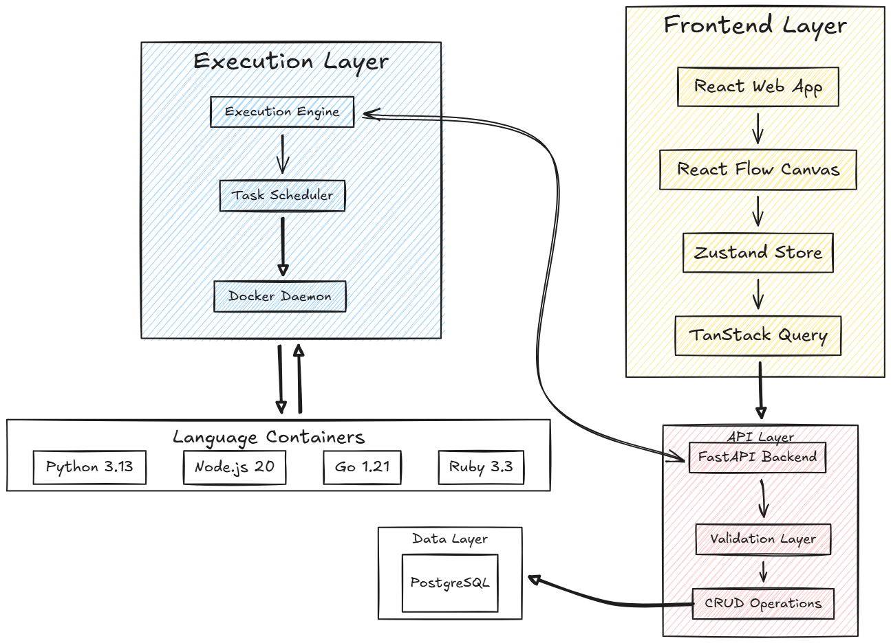
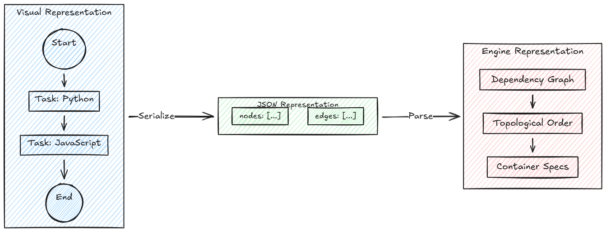

# Orbitium

A visual workflow orchestrator for polyglot scientific pipelines. Draw a pipeline as a graph, write each step in whichever language fits (Python, R, JavaScript, Go, Rust, Ruby), and run it. Every step executes in an isolated Docker container, with a shared volume for passing data between steps.

Built as my software engineering capstone at Al Akhawayn University (Fall 2025), supervised by Dr. Naeem Nisar Sheikh. The full write-up is in [`reports/final_report.tex`](reports/final_report.tex).



## How it works

The web app is a React Flow canvas. A pipeline is a chain of **task** nodes between a **start** and an **end** node; each task holds a title, a language, and a code block edited in Monaco. The graph is persisted as JSON in PostgreSQL through the FastAPI backend.

Running a pipeline hands that JSON to the Go engine, which:

1. walks the graph from the start node and builds the execution order, rejecting cycles;
2. creates one shared Docker volume, mounted at `/shared` in every container;
3. starts one long-lived container per language (images come from `config.yaml`) and reuses it across tasks;
4. executes each task's code with `docker exec`, capturing stdout and stderr;
5. streams per-node status back over stderr, which the API relays to the browser as server-sent events;
6. tears down containers and the volume when done.

Tasks exchange data by reading and writing files under `/shared`.



## Repository layout

```
packages/
  web/     React 19 + Vite, TanStack Router/Query, Zustand, @xyflow/react, Monaco, Tailwind
  api/     FastAPI + SQLModel on PostgreSQL 17 (uv-managed, Python 3.13)
  engine/  Go 1.25 CLI using the Docker SDK
reports/   Capstone interim and final reports (LaTeX) and figures
```

## Running locally

Prerequisites: Docker, Node 20+, Python 3.13 with [uv](https://docs.astral.sh/uv/), Go 1.25+.

**1. Database**

```bash
cp packages/api/base/.env.example packages/api/base/.env
docker compose up -d db          # PostgreSQL 17 on localhost:5433
```

**2. Engine**

```bash
cd packages/engine
go build -o engine ./cmd/engine  # the API looks for packages/engine/engine
```

The engine also runs on its own, without the API or UI:

```bash
go run ./cmd/engine flow-example.json
```

**3. API**

```bash
cd packages/api/base
uv sync
uv run fastapi dev orbitium/main.py   # http://localhost:8000, docs at /docs
```

**4. Web**

```bash
cd packages/web
npm install
npm run dev                            # http://localhost:3000
```

Set `VITE_API_URL` if the API is not on `http://localhost:8000/api/v1`.

## Pipeline format

The engine consumes React Flow's node/edge JSON directly. A minimal pipeline:

```json
{
  "nodes": [
    { "id": "start", "type": "start", "data": { "label": "Start" } },
    {
      "id": "n1",
      "type": "task",
      "data": {
        "title": "Generate",
        "executable": {
          "language": "python",
          "code": "import json\nwith open('/shared/out.json', 'w') as f:\n    json.dump({'result': 42}, f)"
        }
      }
    },
    {
      "id": "n2",
      "type": "task",
      "data": {
        "title": "Report",
        "executable": {
          "language": "r",
          "code": "x <- jsonlite::fromJSON('/shared/out.json'); print(x$result)"
        }
      }
    },
    { "id": "end", "type": "end", "data": { "label": "End" } }
  ],
  "edges": [
    { "source": "start", "target": "n1" },
    { "source": "n1", "target": "n2" },
    { "source": "n2", "target": "end" }
  ]
}
```

Languages map to images in [`packages/engine/config.yaml`](packages/engine/config.yaml); add a line there to support another runtime.

## API

| Method | Path | |
|---|---|---|
| GET | `/api/v1/flows` | list pipelines |
| POST | `/api/v1/flows/create-flow` | create |
| GET | `/api/v1/flows/{id}` | fetch one |
| PUT | `/api/v1/flows/{id}/edit` | save graph changes |
| DELETE | `/api/v1/flows/{id}` | delete |
| GET | `/api/v1/flows/{id}/execute/stream` | run, streaming node status as SSE |
| GET | `/api/v1/flows/{id}/execute` | run, blocking |
| GET | `/api/v1/health-check` | |

## Current limits

- Pipelines are linear chains. Branching and parallel execution are the next step; the DAG model and cycle detection are already in place for it.
- The API launches the engine as a subprocess on the same host, so the API host needs Docker.
- No authentication. This is a single-user development setup.

## License

MIT. See [LICENSE](LICENSE).
